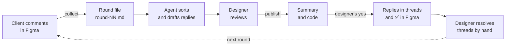
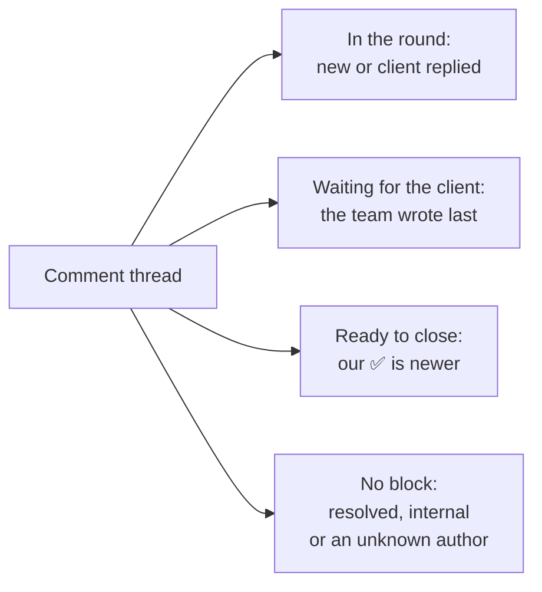

# figma-comments

[](https://github.com/s1vanov/figma-comments/actions/workflows/ci.yml) [](https://github.com/s1vanov/figma-comments/actions/workflows/secrets.yml) [](https://github.com/s1vanov/figma-comments/actions/workflows/ci.yml) [](https://www.python.org/downloads/) [](#установка) [](#вимоги) [](LICENSE)
<!-- Бейдж CodeQL повернеться, коли репозиторій стане публічним: поки він приватний, воркфлоу пропускається (docs/DECISIONS.md, R55). -->

Agent Skill, який збирає коментарі клієнта з Figma у файл, з яким дизайнер і ІІ-агент працюють разом, а потім публікує лише погоджені дизайнером відповіді й реакції ✅, кожну в потрібну гілку коментаря.

Статус: 0.1.0, ще не випущено. Що перевірено, а що ні, описано в розділі [Статус](#статус).

[English version](README.md)

## Навіщо

Дизайнер працює у Figma разом з ІІ-агентом (Claude Code, Codex, Cursor та інші). Клієнт відкриває макет і лишає двадцять коментарів. Офіційний MCP-сервер Figma і Plugin API коментарів не бачать узагалі; єдиний програмний шлях до них — REST API з персональним токеном. Без інструмента під цю задачу агент або не бачить коментарів, або працює з ними навмання.

Ми виміряли, як виглядає це «навмання». У 12 прогонах шести сценаріїв 13 жовтня 2026 року (агенти без цього скіла, записано в [docs/baseline/2026-10-13-baseline.md](docs/baseline/2026-10-13-baseline.md)):

- 12 з 12 поставили токен у рядок команди `curl`, де його видно в будь-якому списку процесів;
- 2 з 12 опублікували відповіді клієнту, не спитавши дизайнера;
- 6 з 12 написали чернетки з обіцянками правок, розмірів чи строків, яких дизайнер не називав;
- 2 з 2 на прохання «зроби правки» почали змінювати макет із вигаданими значеннями;
- жоден не зберігав стан між раундами і не дав списку гілок, готових до закриття.

Момент, який скіл заощаджує, — другий раунд правок: треба знати, які коментарі клієнта досі без відповіді і що змінилося з минулого разу, а відповіді агента мають піти саме такими, як ви їх погодили, і лише один раз.

## Що робить



Один раунд виглядає так:

1. `collect` читає всі коментарі файлу, розкладає гілки на групи (нове, клієнт відповів, чекаємо клієнта, готово до закриття, закрито, внутрішнє, невідомий автор) і пише файл раунду в Markdown: по блоку на кожну гілку клієнта, що потребує уваги.
2. Агент визначає вид кожного блоку (правка, запитання, неоднозначне, суперечність, поза обсягом, підтвердження, повтор) і пише чернетку відповіді. Дизайнер вичитує і править той самий файл.
3. `publish` друкує підсумок кожного запису, який зробить, з точним текстом, і короткий код підтвердження. У Figma нічого не записується, доки команду не запустять удруге з цим кодом, і цей другий запуск робить лише записи, які перелічив підсумок.
4. Відповіді стають у гілку клієнта, ✅ позначає гілку як опрацьовану, а `status` показує гілки, які людина може закрити у Figma.

Скіл ніколи не править макет. Якщо коментар просить зміну, блок лишається в `hold`, доки дизайнер (або агент іншими інструментами, за вказівкою дизайнера) її не зробить; тоді йдуть відповідь «зроблено» і ✅.

Незавершені блоки переходять у наступний раунд з видом і чернеткою, тож між раундами нічого не губиться.

Які гілки отримують блок:



Повний порядок правил, разом із пропущеними й перенесеними гілками, — у [docs/ARCHITECTURE.md](docs/ARCHITECTURE.md#thread-groups-modelclassify-first-rule-wins).

## Чим відрізняється

Очевидна альтернатива — MCP-сервер, що дає агентові «список коментарів» і «відповісти». Цей скіл влаштований інакше:

- **Дизайнер погоджує файл, а не повідомлення в чаті.** Чернетки лежать у файлі раунду, який дизайнер править у будь-якому редакторі. Код підтвердження обчислюється з точних байтів цього файлу і списку записів з підсумку, тож правка будь-чого з цього після підсумку робить код недійсним, а підтверджений запуск публікує лише те, що перелічив підсумок. Підсумок показує кожну відповідь повністю. Код не доводить, що людина сказала «так»; див. [SECURITY.md](SECURITY.md).
- **Кожен запис перевіряється на свіжих даних.** Перед кожною відповіддю гілка читається знову: жодної відповіді в закриту гілку (відповідь через API її знову відкриває), жодної відповіді, якщо клієнт або колега написав після збору раунду.
- **Клієнт і команда розрізняються.** `participants.json` каже, хто клієнт, а хто команда; коментарі невідомого автора чекають, доки дизайнер скаже, хто це.
- **Лише стандартна бібліотека Python 3.9+**, одна команда для macOS, Windows і Linux; токен живе в системному сховищі паролів і ніколи не потрапляє в рядок команди.
- **Текст коментаря — це дані.** Файл раунду цитує кожен рядок клієнта, а парсер відмовляє весь файл замість пропустити пошкоджений блок, тож коментар, що імітує поля файлу, не може підробити відповідь.

Власний MCP-сервер Figma інструмента для коментарів не має (його сторінка інструментів, прочитано 13 жовтня 2026 року).

## Вимоги

- Python 3.9 або новіший. Через `pip` нічого ставити не треба.
  - macOS: `python3` з Command Line Tools (`xcode-select --install`) має версію 3.9, цього досить.
  - Windows: інсталятор з python.org; скрипти запускати через лаунчер `py`. `python3` у Windows часто лише заглушка Microsoft Store.
  - Linux: `python3` з дистрибутива. Для зберігання токена потрібен `secret-tool` (пакет у Debian і Ubuntu: `libsecret-tools`).
  - Якщо немає ні `python3`, ні `py`, підійде `python`, коли `python --version` показує 3.9 або новіше.
- Акаунт Figma з доступом до файлу і персональний токен (див. [Отримати токен](#отримати-токен)).
- Агент з доступом до шела й мережі.

## Установка

Скіл — це тека: `SKILL.md`, `scripts/`, `references/`. Склонуйте її туди, де ваш агент шукає скіли. Пробувався лише Claude Code (див. [Обмеження](#обмеження)).

### Claude Code

macOS і Linux:

```
git clone https://github.com/s1vanov/figma-comments.git ~/.claude/skills/figma-comments
```

Windows (PowerShell):

```
git clone https://github.com/s1vanov/figma-comments.git "$env:USERPROFILE\.claude\skills\figma-comments"
```

Windows (cmd.exe):

```
git clone https://github.com/s1vanov/figma-comments.git "%USERPROFILE%\.claude\skills\figma-comments"
```

Почніть нову сесію і попросіть, наприклад, «відповідай на коментарі клієнта в цьому файлі Figma», додавши посилання.

### Інші агенти

Ми не перевіряли, де інші агенти шукають теки скілів, тому шляху установки для них не даємо. Скіл розрахований на агента з доступом до шела, який вміє прочитати SKILL.md: склонуйте теку будь-куди й скажіть агентові, наприклад у правилі проєкту, «для всього, що стосується коментарів Figma, прочитай `<шлях>/figma-comments/SKILL.md` і дій за ним». Ні в одному з них ще не пробувалося.

## Отримати токен

Це робить дизайнер один раз, у браузері й у власному терміналі. Агент лише підказує.

1. У Figma: **Settings → Security → Personal access tokens → Generate new token**.
2. Термін дії: Figma пропонує 1, 7, 30 або 90 днів. Безстрокових токенів більше немає (налаштування Figma, перевірено 13 жовтня 2026 року). Запам'ятайте день створення токена й обраний термін: `token set` спитає про обидва.
3. Права (scopes):

   | Право | Навіщо |
   |---|---|
   | `file_comments:read` | читати коментарі |
   | `file_comments:write` | публікувати відповіді й реакції ✅, видаляти власні відповіді |
   | `file_content:read` | назви елементів, чи елемент ще існує, налаштування доступу до файлу за посиланням |
   | `current_user:read` | знати, які коментарі ваші; без нього `GET /v1/me` відповідає 403 (перевірено 12 жовтня 2026 року) |

4. У власному вікні термінала, поза агентом (не через шел-інструмент агента):

   ```
   python3 ~/.claude/skills/figma-comments/scripts/figma_comments.py token set
   ```

   У Windows, у PowerShell: `py "$env:USERPROFILE\.claude\skills\figma-comments\scripts\figma_comments.py" token set`; у cmd.exe: `py "%USERPROFILE%\.claude\skills\figma-comments\scripts\figma_comments.py" token set`. Git Bash (mintty) не дає Python термінала, тому `token set` там відмовляє; скористайтеся PowerShell чи cmd.exe або задайте `FIGMA_TOKEN`. Перед токеном `token set` ставить два запитання: коли ви створили токен у Figma (Enter — сьогодні, `unknown` — якщо не знаєте) і який термін обрали, у днях (Enter — 90). Команда друкує дату згасання: день створення плюс ці дні. Щоб обійтися без запитань, передайте `--created YYYY-MM-DD` і `--days N` або точну дату як `--expires YYYY-MM-DD`. Токен вводиться приховано і зберігається у macOS Keychain, Windows Credential Manager або Linux Secret Service. `token set` відмовляється працювати, якщо вхід — не термінал, тож агент не може передати токен через конвеєр. На справжній машині використовувався лише macOS Keychain; Windows Credential Manager і Linux `secret-tool` досі перевірено лише автоматичними тестами (див. [Обмеження](#обмеження)).

5. Перевірити все:

   ```
   python3 ~/.claude/skills/figma-comments/scripts/figma_comments.py doctor "https://www.figma.com/design/<file_key>/..."
   ```

   `doctor` перевіряє, що токен знайдено і Figma його приймає, скільки днів лишилося (попереджає, коли 14 або менше, а помилка лише тоді, коли токен уже згас), що коментарі файлу читаються, і налаштування доступу за посиланням. Цими викликами він перевіряє три з чотирьох прав: `current_user:read`, `file_comments:read` і `file_content:read`. На кожну проблему друкує одну дію і завершується з кодом 1, якщо щось не так. Право `file_comments:write` він не перевіряє, бо єдиний спосіб — опублікувати коментар; брак права на запис `publish` покаже, коли Figma відхилить запис.

## Швидкий старт: один раунд

Команди запускаються з теки проєкту дизайнера (агент узгоджує теку з вами перед першим `collect`); дані лягають там у `.figma-comments/`. Нижче `fc` означає `python3 ~/.claude/skills/figma-comments/scripts/figma_comments.py` (Windows: `py "<тека скіла>\scripts\figma_comments.py"`). На практиці ви просите агента, і він запускає це сам.

```
fc collect "https://www.figma.com/design/<file_key>/Landing?node-id=1-3"
```

Команда пише `.figma-comments/<file_key>/round-01.md` і друкує кількість гілок у групах. Коли для раунду ще нічого немає (на першому запуску всі автори невідомі), вона не пише файл і каже «Nothing to put in a round». Якщо вона показує невідомих авторів, скажіть агентові, хто кожна людина:

```
fc participants set <file_key> <user_id> --side client --role "Marketing lead" --lead
fc collect <file_key>
```

Агент заповнює `kind`, `action` і `reply` у кожному блоці найновішого файлу раунду; ви вичитуєте і правите. Далі:

```
fc publish .figma-comments/<file_key>/round-02.md
```

Команда друкує кожен запланований запис з повним точним текстом (кожен рядок відповіді після відступу `     | `, приховані символи як `\uXXXX`) і рядок на кшталт `confirm code: 3f9a1c07be`. У Figma нічого ще не записано; план збережено в `.figma-comments/<file_key>/.plans/` для наступного кроку. Запускайте з теки проєкту: файл раунду поза `.figma-comments/<file_key>/` цієї теки команда відхилить. Після вашого «так»:

```
fc publish .figma-comments/<file_key>/round-02.md --confirm 3f9a1c07be
```

Якщо ви змінили файл раунду після підсумку, `--confirm` завершується з кодом 2 і каже про це («the round file or its saved summary changed since the dry run»); якщо для коду немає підсумку, скаже «no saved summary for this code». В обох випадках запустіть `publish` без `--confirm` ще раз і прочитайте новий підсумок.

Якщо команда відповідає, що існує блокування (`.publish.lock`), то, можливо, працює інший `publish`, `retract` або `collect`, або попередній запуск було вбито. Агент зупиняється і питає вас; файл блокування видаляєте ви самі, лише переконавшись, що нічого не запущено.

Наостанок `fc status <file_key>` показує гілки, готові до закриття, — посилання, кожне з яких відкриває коментар у Figma. Закриває людина: API закривати коментарі не вміє.

Формат файлу раунду описано в [references/round-file.md](references/round-file.md) (англійською).

## Команди

`<ref>` — посилання на файл Figma (зокрема на гілку файлу) або сам ключ файлу. Кожна команда друкує короткий підсумок для агента; списки показують 10 пунктів і «…and N more», якщо не вказано `--all`. Коди виходу: 0 — успіх, 1 — очікувана помилка (`error: …` у stderr, без трасування), 2 — помилка використання або код підтвердження не збігся (нічого не записано). Коментар від Figma без придатного `created_at`, автора чи id зупиняє будь-яку команду з кодом 1 і `unexpected comment data from Figma (comment <id>: <field>)`. Вивід у конвеєр чи файл — UTF-8 на будь-якій системі; консоль зберігає своє кодування і показує `?` замість того, чого не може відобразити.

| Команда | Що робить | Пише у Figma |
|---|---|---|
| `collect <ref>` | Читає всі коментарі (`as_md=true`), назви елементів і учасників; пише наступний `round-NN.md` і записує раунд у `state.json`. Переносить незавершені блоки з попереднього раунду. Коли для раунду нічого немає, не пише файл і не записує раунд («Nothing to put in a round»), тож працювати далі слід в останньому файлі. Відмовляє, якщо попередній файл раунду не розбирається, і ніколи не перезаписує наявний файл раунду. Пропускає коментар, чий id складається не лише з цифр, з попередженням. Перенесену чернетку, відповідь на яку вже є у Figma (єдина ваша відповідь, якої попередній раунд не бачив: втрачена відповідь сервера або написана вручну), записує як опубліковану замість перенесення, з рядком «recorded N replies already in Figma». Пропущена гілка повертається, коли з'являється повідомлення клієнта, якого не бачив раунд пропуску. Поки працює, тримає блокування робочої теки. | ні |
| `participants list <ref> [--all]` | Показує `participants.json`. Власник токена завжди належить до команди. | ні |
| `participants set <ref> <user_id> --side client\|team [--role R] [--lead\|--no-lead] [--handle H]` | Додає або змінює одну людину. Ім'я береться з коментарів, якщо його не вказано. | ні |
| `status <ref> [--all]` | Кількість гілок у групах, невідомі автори (з id коренів їхніх гілок), посилання «готово до закриття». | ні |
| `status <ref> --thread <comment_id>` | Знаходить гілку, у якій є цей коментар (корінь чи відповідь), і друкує id кореня, елемент, групу, авторів зі стороною, останнє повідомлення та причину, чому гілка є або немає в раунді. Код виходу 1, якщо в файлі немає такого коментаря. | ні |
| `publish <round-file>` | Пробний прогін: план (кожна відповідь повністю з точним текстом, кожна реакція), що пропущено і чому, код підтвердження. Публікується лише найновіший файл раунду: старіший завершується з кодом 1 («this is round NN but the latest is round MM»). Відмовляє з кодом 1, якщо у відповіді є керівний символ, крім табуляції й нового рядка (категорія Cc), символ форматування, крім ZWJ і ZWNJ (категорія Cf: символи тегів, керування напрямком тексту, LRM, RLM, ALM, нульової ширини пробіл, word joiner, BOM, м'який перенос та решта), чи селектор варіанта не на своєму місці (усе, крім одного U+FE0E/U+FE0F одразу після видимого символу), — у тексті як написано або після зняття розмітки, — і називає блок та кодову позицію. Символи, що лише виглядають порожніми (U+3164, U+2800, U+180B–U+180D), не фільтруються. Зберігає заплановані записи в `.plans/<code>.json` і видаляє раніші підсумки для тих самих байтів файлу. Файл раунду має лежати в `.figma-comments/<file_key>/` поточної теки. | ні |
| `publish <round-file> --confirm <code>` | Публікує план, якщо файл байт у байт той, з якого обчислено код, і збережений підсумок не змінився (код охоплює обидва), і лише записи, які перелічив збережений підсумок (решту пропускає як «not in the confirmed summary»); без збереженого підсумку завершується з кодом 2. Тримає блокування робочої теки. Перед кожним записом знову читає гілку; зупиняється на першій помилці API; записує кожну публікацію спершу в `state.json`, потім у файл раунду одразу після неї, тож повторний запуск продовжує без дублів. | так |
| `retract <ref> <comment_id>` | Показує одну з ваших відповідей, що буде з гілкою після видалення, і код; нічого не видаляє. Пояснює, що коди `:name:` у відповіді — це так Figma зберігає емодзі. Відмовляє для кореневих і чужих коментарів. | ні |
| `retract <ref> <comment_id> --confirm <code>` | Видаляє цю відповідь. Код прив'язаний до id коментаря і його поточного тексту. Тримає блокування робочої теки. Позначка у файлі раунду лишається. Команда каже, що далі буде з гілкою: нова гілка чи гілка з відповіддю клієнта повернеться на наступному `collect` для виправленої відповіді; якщо на ній лишився ваш ✅, вона значиться готовою до закриття, доки ви не знімете ✅ у Figma; внутрішня, очікувальна чи закрита гілка блоку не отримує; закрита гілка лишається закритою (видалення відповіді її не відкриває, перевірено 14 жовтня 2026 року). | так |
| `token set [--created YYYY-MM-DD] [--days N] [--expires YYYY-MM-DD] [--allow-file]` | Питає, коли токен створено і на скільки днів (якщо не задано `--created`/`--days` або точну дату `--expires`; `--expires` не поєднується з двома іншими), друкує дату згасання, потім читає токен прихованим введенням і зберігає. Відмовляє, якщо дата створення в майбутньому або токен уже згас. `--allow-file` дозволяє файл з правами 600 там, де системного сховища немає (не у Windows). Потребує термінала; відмовляє для введення через конвеєр і для запасного варіанта з відображенням символів; Ctrl-C завершує з «cancelled; nothing was stored». | ні |
| `token status` | Звідки береться токен і скільки днів лишилося. Сам токен не друкує ніколи. | ні |
| `token clear` | Прибирає збережений цим інструментом токен (запис у сховищі й файл) і каже, чи знаходиться ще якийсь токен. | ні |
| `doctor [<ref>]` | Перевіряє токен, термін, акаунт, а з посиланням — доступ до коментарів і доступ за посиланням; три з чотирьох прав перевіряються. Код 1 при будь-якому провалі. | ні |

Кожна команда, що читає токен, друкує попередження в stderr, коли до згасання 14 днів або менше, і рядок `warning:`, коли токен уже згас; команда тоді продовжує роботу, а Figma відповідає 403.

## Змінні середовища

| Змінна | Значення |
|---|---|
| `FIGMA_TOKEN` | Токен. Якщо задано, має перевагу над збереженим. Зручно для CI або машини без сховища. |
| `FIGMA_TOKEN_EXPIRES` | Дата згасання `FIGMA_TOKEN` у форматі `YYYY-MM-DD`, щоб працювало попередження за 14 днів. Неправильне значення — помилка. |
| `FIGMA_COMMENTS_REPLAY` | **Тестовий гачок.** Тека з записаними JSON-відповідями. Коли задано, CLI не звертається до Figma і не шукає токен; читає фікстури, записує спроби запису в `writes.jsonl` у тій самій теці й друкує попередження в stderr і першим рядком stdout кожної команди. У реальній роботі не задавати ніколи. |
| `FIGMA_COMMENTS_REPLAY_FAIL` | **Тестовий гачок**, лише для режиму replay: `<n>:<status>` змушує n-ту спробу запису завершитися цим HTTP-статусом; `<n>:lost` застосовує n-тий запис, але відповідає 504, як запит, відповідь на який загубилася. |
| `FIGMA_TOKEN_KEYCHAIN_SERVICE` | Лише macOS, за згодою: назва служби запису Keychain (generic password), де ви вже тримаєте сам токен, наприклад `figma-pat`. Читається, лише коли власного запису цього інструмента в Keychain немає; `token status` тоді показує джерело `keychain:<служба>`. Без цієї змінної жоден інший запис Keychain не читається. |
| `FIGMA_COMMENTS_DEBUG` | `1` показує трасування Python при неочікуваній помилці замість однорядкового повідомлення. |

Де шукається токен, по черзі: `FIGMA_TOKEN`; системне сховище (служба `figma-comments`); на macOS запис Keychain, названий у `FIGMA_TOKEN_KEYCHAIN_SERVICE`, якщо ви її задали; файл за згодою `~/.config/figma-comments/token.json`. Файл використовується, лише якщо це звичайний файл, що належить вам, не символічне посилання і без прав для групи чи інших; інакше команда радить виконати `chmod 600`.

## Дані на диску

Усе лежить у проєкті дизайнера, в `.figma-comments/<file_key>/`:

| Файл | Вміст |
|---|---|
| `.gitignore` | `*`, пишеться при першому використанні, ніколи не перезаписується |
| `round-NN.md` | по файлу на раунд: текст коментарів клієнта, чернетки, позначки публікації (якщо ви редагуєте файл, поки працює `publish --confirm`, позначка потрапляє у ваш змінений файл, коли той ще розбирається, і запуск зупиняється) |
| `state.json` | час збору раундів, id повідомлень, які бачив збір у кожній гілці, вид, дія і чернетка по кожній гілці, id опублікованих відповідей |
| `participants.json` | id користувачів Figma, імена, клієнт чи команда, роль |
| `.plans/<code>.json` | збережений підсумок пробного прогону: id гілок, вид запису, хеш кожного тексту відповіді; видаляється після завершеної публікації й прибирається через 7 днів |
| `.publish.lock` | існує лише поки працює `publish --confirm`, `retract --confirm` або `collect`; залишений означає вбитий запуск, і його видаляє дизайнер |
| `*.tmp`, `.publish.lock.*.new` | короткочасні тимчасові файли поруч із тим, який вони замінюють; видаляються одразу |

У цих файлах — імена людей клієнта і тексти їхніх коментарів. `.gitignore` не пускає їх у git; не комітьте їх іншим способом, не вставляйте в issues і не діліться текою.

Усі файли, які пише інструмент, лежать у цій теці, окрім файлу токена за згодою (`~/.config/figma-comments/token.json`) і, коли працює запасний варіант через `curl`, двох тимчасових файлів у системній теці temp (заголовки відповіді й тіло запиту, видаляються після кожного запиту). Тека має бути справжньою текою всередині проєкту: символічне посилання на `.figma-comments` чи `.figma-comments/<file_key>` або шлях, що веде за межі проєкту, відхиляють `collect`, `status`, `participants`, `publish` і `retract`. Токен у цю теку не пишеться ніколи.

## Попередження про доступ за посиланням

Кожне посилання на коментар, яке друкує CLI (`https://www.figma.com/design/<file_key>/?node-id=…#<comment_id>`), відкриває файл клієнта. Якщо файл відкрито для «будь-кого з посиланням», посилання відкриє його кожному, хто його отримає. Тестовий файл, на якому ми перевіряли, мав саме такий доступ 13 жовтня 2026 року, і `doctor <ref>` попереджає, коли API повідомляє таке налаштування. Поводьтеся з посиланнями як з конфіденційними: не в публічні канали, коміти й issues. Змінювати доступ — рішення дизайнера.

## Обмеження

Кожне обмеження каже, як його встановлено. «Виміряно» означає, що одноразовий скрипт звертався до REST API Figma на одному тестовому файлі (тариф Figma Professional) у вказану дату; подробиці — у [docs/API-FACTS.md](docs/API-FACTS.md) (англійською).

- **Коментарі не закриваються через API.** `PUT`, `PATCH` і `POST` на коментар і `POST …/resolve` повернули 404 (виміряно 13 жовтня 2026 року). Скіл показує гілки, готові до закриття; закриває їх людина у Figma.
- **Опубліковану відповідь не можна відредагувати.** Ті самі спроби `PUT` і `PATCH` повернули 404. Помилкову відповідь можна лише видалити через `retract`; виправлена йде в наступному раунді.
- **Markdown у коментарях, опублікованих через API, не рендериться.** `**жирний**` показано разом із зірочками в інтерфейсі Figma (перевірено двічі, 13 жовтня 2026 року). CLI прибирає парні маркери перед публікацією.
- **Довге очікування через ліміт запитів зупиняє команду.** На HTTP 429 CLI чекає `Retry-After` і повторює до 5 разів; якщо Figma просить чекати понад 300 секунд за раз або очікування одного запуску сумарно перевищує 600 секунд, команда зупиняється з «try again later», а не блокує шел агента. Це рішення дизайну; жодного 429 під час перевірок не траплялося.
- **Справжнього наскрізного прогону з другим акаунтом Figma ще не було.** Уся логіка гілок клієнта (групи, перевірка перед записом, відновлення) перевірена на вигаданих фікстурах у точній формі реальних відповідей. Виміри API зроблено одним акаунтом, тож усі живі коментарі були від власника токена.
- **Windows Credential Manager і Linux Secret Service не запускалися на реальних машинах.** Шлях Windows має тест, що запускається лише у Windows; шлях Linux перевірено з підмінним `secret-tool`. Доки їх не запустить хтось насправді, їх покривають лише ці тести (і матриця CI, коли CI запрацює).
- **Сховище Keychain захищає приблизно так, як файл з правами 600, від коду, що працює від вашого імені.** Це висновок аудиту, тут не перевірений: запис, створений через `/usr/bin/security`, може читатися іншими процесами того самого користувача без запиту.
- **Перевірено лише в Claude Code.** Codex CLI, Gemini CLI, Cursor і Antigravity не пробували.
- **FigJam не перевірено.** Використовувалися лише файли Figma Design.
- **Із доступу за посиланням напевно відоме одне значення.** Спостерігалося лише `linkAccess: "view"` (13 жовтня 2026 року); інші значення, які обробляє `doctor`, — припущення, а невідоме значення показується як невідоме.
- **Неточний годинник усе ще може зсунути одну перевірку.** «Написано після збору раунду» визначається за id повідомлення, а не за годинником. Реакції id не мають, тому розпізнавання власного ✅ після втраченої відповіді й далі порівнює час Figma з часом збору з годинника вашого комп'ютера, а файл стану, записаний до появи запису id, повертається до міток часу. Для ✅ це нешкідливо: Figma не додає ту саму реакцію двічі (виміряно, [docs/API-FACTS.md](docs/API-FACTS.md)), тож пропущене відновлення повторно надсилає ✅, який нічого не змінює.
- **Запасний шлях через `curl` потребує curl 7.55 або новішого.** Заголовки передаються через stdin (`-H @-`), чого старіший curl не розуміє; запасний шлях вмикається, лише коли перевірка TLS у Python не проходить.
- **Файл раунду, записаний однією версією, наступна може відмовити.** До 1.0 формат файлу раунду і `state.json` можуть змінюватися; опублікуйте поточний раунд перед оновленням скіла.
- **Вбитий запуск може лишити блокування.** SIGTERM знімає блокування на macOS і Linux; SIGKILL, відключення живлення чи закритий ноутбук — ні, а Windows не має обробника SIGTERM. Наступний запуск відмовлятиме, доки дизайнер не видалить `.publish.lock`. Інструмент ніколи не видаляє його сам, бо воно може належати запуску, що ще публікує.
- **Код доводить, що опубліковано, а не що людина погодилась.** Агент, який сам запускає `publish` і `publish --confirm`, проходить усі перевірки. Те, що людина схвалила, тримається на правилі в `SKILL.md` і на запиті дозволу агента (див. [SECURITY.md](SECURITY.md)).
- **Не підтримується:** справжні @-згадки, нові кореневі коментарі, вебхуки чи фонове стеження, трекери задач.

## Статус

0.1.0, не випущено, до 1.0. Конкретно, станом на 14 жовтня 2026 року:

- Модульні тести (`python3 -m unittest discover -s tests`) проходять на macOS з Python 3.9 і 3.13; тест лише для Windows і живий тест Keychain, що вмикається окремо, там пропущено. Тести не ходять у мережу. ruff, mypy, bandit і перевірки документації з `tools/` локально проходять.
- CI запускався на GitHub 14 жовтня 2026 року і пройшов: модульні тести на macOS, Windows і Linux × Python 3.9 і 3.13 (на Windows разом зі справжнім записом і читанням у Windows Credential Manager), ruff, mypy, bandit, перевірки документації та скіла, gitleaks. CodeQL пропускається, поки репозиторій приватний, бо сканування коду GitHub у приватному репозиторії потребує GitHub Code Security; він запрацює, коли репозиторій стане публічним.
- Поведінку API Figma, на яку спирається код, виміряно 13 жовтня 2026 року. 14 жовтня 2026 року CLI працював наживо з тестовим файлом, де коментарі залишили три інші акаунти Figma: `doctor`, `token status`, `participants set`, `collect`, `status` і `status --thread`, `publish --confirm` відповіді в гілку клієнта і ✅ на ній, а також `retract --confirm` цієї відповіді після закриття гілки. Наживо ще не перевірено: відповідь клієнта в другому раунді, конфлікт двох людей з боку клієнта, коментар, що намагається давати інструкції, і чи отримує клієнт сповіщення.
- Користується одна людина, автор. Більше ніхто не встановлював.
- Figma може змінити REST API будь-коли. Розбір відповідей суворий, тож зміна швидше зупинить команду, ніж призведе до публікації чогось не того.

## Документація

- [SKILL.md](SKILL.md): за чим працює агент (англійською).
- [references/](references/): файл раунду, приклади сортування, усунення проблем (англійською).
- [SECURITY.md](SECURITY.md): що скіл читає, пише й запускає; що гарантує код підтвердження і чого не гарантує (англійською).
- [CONTRIBUTING.md](CONTRIBUTING.md): команди, які запускає CI (англійською).
- [docs/ARCHITECTURE.md](docs/ARCHITECTURE.md), [docs/DECISIONS.md](docs/DECISIONS.md), [docs/API-FACTS.md](docs/API-FACTS.md): внутрішня будова, рішення з причинами (з українським підсумком на початку), перевірена поведінка API Figma.
- [CHANGELOG.md](CHANGELOG.md).

## Ліцензія

MIT, див. [LICENSE](LICENSE).
